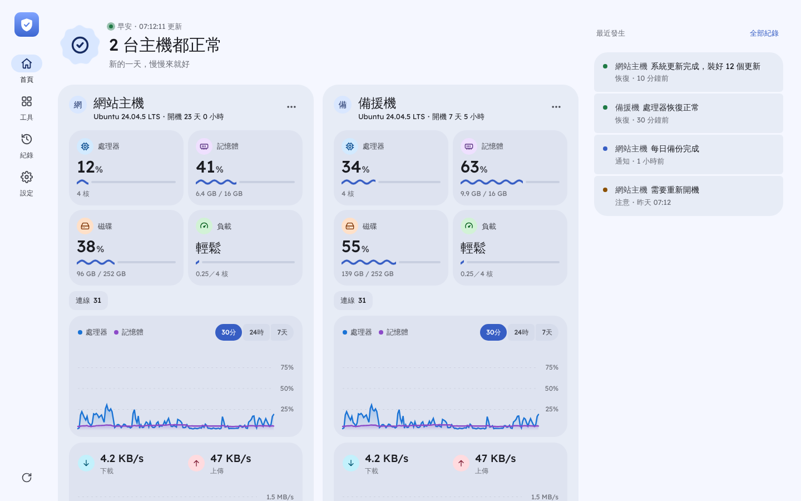
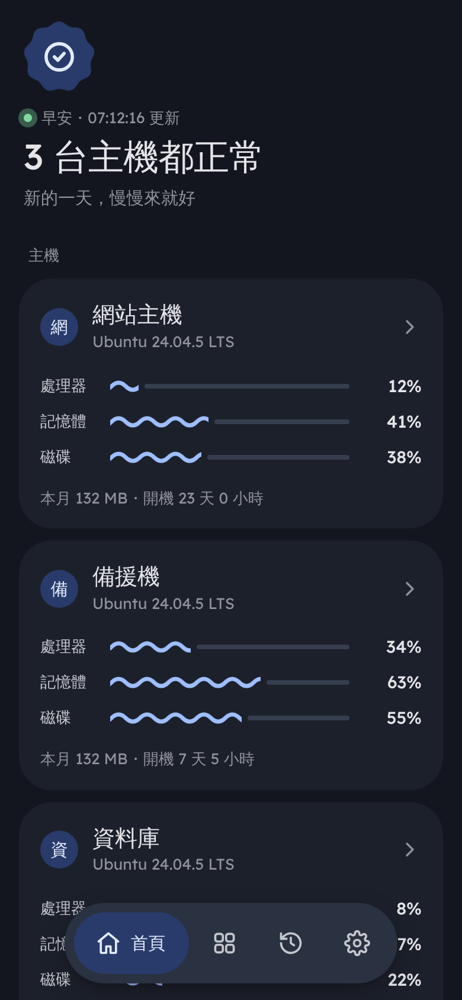

# 🛡️ VPS 哨兵

**用手機或電腦，隨時看你的 VPS 有沒有事。**

裝在 VPS 上，打開一個網址就能看到每台主機的處理器、記憶體、磁碟、網路和 Docker 容器；出狀況會傳 Telegram 通知你。
只用 Python 內建的功能，不用另外裝資料庫或其他軟體。

<p align="center">
  
  
</p>

---

## ✨ 可以做什麼

**看狀態**
- 📊 處理器、記憶體、磁碟、負載、網路速度、連線數，最近 30 分鐘／24 小時／7 天的曲線
- 📶 每月流量：用了多少、月底預估、快超過上限會提醒
- 🐳 Docker 容器、系統服務有沒有在跑
- 🖥️ 很多台一起看：有狀況的排最前面，首頁一句話告訴你「有沒有事」

**通知**
- 💬 Telegram：出問題、恢復、有人登入主機、主機重新開機、更新完成、備份失敗，開頭都有狀態符號；舊訊息會自動刪掉
- 🔐 網址的安全憑證快過期、常用連結打不開，也會提醒

**工具**（在「工具」分頁）
- ✈️ 機場起降：像機場那種會翻牌的看板，看附近正在降落、起飛、滑行的飛機（航班、機型、註冊號、從哪來），加上雷達圖；全世界的機場都能切換，台灣主要機場釘在最上面。資料來自 [adsb.fi](https://adsb.fi)、[OpenSky](https://opensky-network.org) 等愛好者共享的接收站，不用註冊、只限個人使用
- ☁️ 雲端硬碟：網頁版的檔案空間，跟哨兵一起登入
- ⬇️ 遠端下載：貼上連結，主機幫你下載到雲端硬碟（大檔案會分段同時下載）
- 🔗 常用連結：一點打開 3x-ui、n8n 這類後台，順便檢查打不打得開
- 🗄️ 每日備份：每天自動把重要設定加密備份，每台都存著每一台的

**安全**
- 🔑 手機金鑰（指紋、臉部辨識）、PIN 碼登入，「30 天內不用再登入」
- 🔄 一鍵換密碼；從網頁重新開機要 Telegram 驗證碼
- 🧩 新增主機用一次性的配對暗號，兩台各自算出連線鑰匙，不在網路上傳

**其他**
- ⬆️ 網頁上一鍵更新哨兵、雲端硬碟、系統；新版打不開會自動退回舊版
- 🌲 Oracle 免費主機防回收：每天幾段時間把處理器用量補到 25%，避免被當成閒置收回
- 🎨 深淺色、11 種主題色、3 種配色風格、文字大小

---

## 🚀 安裝

用 root 登入 VPS（一般帳號先輸入 `sudo -i`），貼上：

```bash
git clone https://github.com/a7510049/vps-sentinel.git ~/vps-sentinel
cd ~/vps-sentinel && bash install.sh
```

會問兩件事：

1. **全新安裝** 或 **從備份還原**
2. 網域（沒有就按 Enter）

裝好後畫面會給你一個網址，用手機或電腦打開就好（第一次會自動記住密碼）。

### 有網域的話

先到網域商新增一筆 **A 紀錄** 指向 VPS 的 IP，再執行：

```bash
cd ~/vps-sentinel && bash install.sh 你的網域
```

網址會變成 `https://你的網域`。443 埠被佔用（例如 3x-ui）時會自動改用 **9443**；80 埠被 nginx 佔用也不會搶，原本的網站不受影響。

### ⚠️ 雲端主機的防火牆

Oracle、AWS、GCP 這類主機，要到雲端主機的網站打開連接埠（TCP）：

| 安裝方式 | 要開的連接埠 |
|---|---|
| 沒有網域 | 8787 |
| 有網域 | 80，以及 443 或 9443（看安裝完給的網址） |

### 📱 加到手機主畫面

- **iPhone**：用 Safari 打開網址 →「分享」→「加入主畫面」
- **安卓**：可以裝 [安卓 App](https://github.com/a7510049/vps-sentinel/releases/tag/android)（下載 `vps-sentinel.apk`），第一次打開輸入主機網址就好；新版直接蓋過舊版

---

## 🖥️ 新增主機

每台 VPS 都先照上面裝好。新主機裝好時，畫面最後會給一組 `VS-` 開頭的**配對暗號**（24 小時內、用一次就失效）：

1. 在主要那台的網頁首頁，按主機列表最後的「新增主機」
2. 貼上暗號

之後打開主要那台就能看到全部。暗號過期了，可以在新主機的「設定 → 主機 → 配對暗號」重新產生。
被加進來的主機，自己的網頁只會顯示「由誰監看中」；主要那台 5 分鐘沒連過來，它會自己傳 Telegram 通知你。

---

## 🔄 更新

在網頁「設定 → 主機」，有新版時按「更新」；好幾台都有新版時會出現「全部更新」。
新版打不開的話會自動換回舊版，並通知你。

也可以在主機上手動更新：

```bash
cd ~/vps-sentinel && git pull && bash install.sh
```

設定（密碼、名稱、網域…）都會保留。

---

## ☁️ 雲端硬碟（選用）

一行裝好網頁版的雲端硬碟（[FileBrowser Quantum](https://github.com/gtsteffaniak/filebrowser)），可以上傳、下載、分享：

```bash
cd ~/vps-sentinel && sudo bash cloud.sh 50
```

數字是**容量上限（GB）**，放滿就是滿了，不會吃掉整台主機的磁碟。裝好後在「工具」分頁點「雲端硬碟」就直接進去，不用另外的帳號密碼。

| 要做什麼 | 指令 |
|---|---|
| 改容量 | `sudo bash cloud.sh 100` |
| 更新（網頁「設定 → 主機」也能按） | `sudo bash cloud.sh 更新` |
| 打不開時找原因 | `sudo bash cloud.sh 檢查` |
| 移除（檔案會保留） | `sudo bash cloud.sh 移除` |

### 遠端下載影片

YouTube、B 站這類影片網址要先在主機上自己裝 [yt-dlp](https://github.com/yt-dlp/yt-dlp)（有 ffmpeg 才會下載最好的畫質）；裝好後哨兵每天會幫它更新。
YouTube 會擋機房的 IP：主機有 Cloudflare WARP（`127.0.0.1:40000`）會自動走它，或在設定檔填 `YT_PROXY`；還是被擋的話，可以在下載視窗貼上網站登入資料。

---

## 🗄️ 每日備份與還原

裝好就會自動開始，不用設定。每天清晨 4 點把這些加密打包：

- 3x-ui、n8n、哨兵、Caddy／nginx、雲端硬碟的設定
- 安全憑證（acme.sh、3x-ui 用到的憑證和私鑰）、root 的排程（crontab）

可以重新下載的（Docker 映像檔、程式本身）不備份；雲端硬碟裡的檔案太大也不備份，重要的請自己另外留一份。

**放在哪**：每台主機都存著每一台的備份，在雲端硬碟的「哨兵備份」資料夾（沒有雲端硬碟就放在主機上），每台留 7 份。有 Telegram 的話也會安靜傳一份最新的。

**密碼**：總密碼在「工具 → 每日備份」，點一下才顯示，**請另外記好**，每一份都打得開。每一份備份也有自己的密碼（Telegram 私人對話會附上，打碼），只打得開那一份。

**加密方式**：scrypt（讓猜密碼很慢）＋ AES-256 ＋ HMAC-SHA256（密碼錯或檔案被改過都會發現）。

### 還原

- **整台搬到新主機**：在新主機執行 `bash install.sh`，選「從備份還原」，用畫面給的網址上傳備份檔（`.vsbk`）、輸入密碼，網頁會顯示進度，最後告訴你每個服務有沒有跑起來。3x-ui 要先用它官方的指令裝好。記得先把網域改指向新主機。
- **回到前幾天的樣子**：在那台主機執行

  ```bash
  sudo python3 ~/vps-sentinel/sentinel.py --restore
  ```

  從清單挑一份、輸入密碼。原本的檔案會先另存在 `/root/還原前的檔案-時間.tar.gz`。
- **只想解開看看**：`python3 sentinel.py --decrypt 備份檔.vsbk`

---

## ⚙️ 設定檔

大部分在網頁上就能設定。少數進階的在 `/etc/vps-sentinel-lite.conf`，改完執行 `systemctl restart vps-sentinel-lite`。

| 項目 | 說明 |
|---|---|
| `TOKEN` | 登入密碼 |
| `SERVICES` | 要監看的系統服務，例如 `nginx,ssh` |
| `ALERT_CPU`、`ALERT_MEM`、`ALERT_DISK` | 超過幾 % 算異常（預設 90） |
| `COUNTRY` | 國旗判斷錯時手動指定，例如 `JP` |
| `BACKUP`、`BACKUP_HOUR` | 每日備份開關（`on`／`off`）、幾點備份（預設 4） |
| `BACKUP_PATHS` | 還想一起備份的資料夾或檔案，用逗號隔開 |
| `KEEPALIVE` | `off` 關掉 Oracle 防回收 |
| `YT_PROXY` | 下載影片走的代理，例如 `socks5://127.0.0.1:40000` |

---

## 🧰 常用指令

| 要做什麼 | 指令 |
|---|---|
| 看有沒有在跑 | `systemctl status vps-sentinel-lite` |
| 看執行紀錄 | `journalctl -u vps-sentinel-lite -n 50` |
| 忘記密碼 | `grep TOKEN /etc/vps-sentinel-lite.conf` |
| 重新啟動 | `systemctl restart vps-sentinel-lite` |

### 完全移除

```bash
systemctl disable --now vps-sentinel-lite
rm -rf /opt/vps-sentinel-lite /var/lib/vps-sentinel-lite /etc/vps-sentinel-lite.conf /etc/systemd/system/vps-sentinel-lite.service /etc/caddy/sites/vps-sentinel.d /etc/caddy/sites/vps-sentinel.caddy
systemctl reload caddy 2>/dev/null; systemctl daemon-reload
```

### 從舊版（Home Assistant 版）升級

裝好新版後執行 `bash cleanup-old.sh`，它會先列出舊東西，確認後才刪，不會動到其他容器。

---

## 📄 授權

MIT，可以自由使用與修改。
